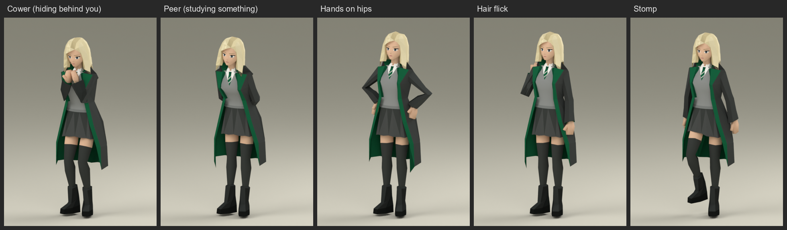

# Malfoid

A companion for Old School RuneScape on RuneLite: a sharp-tongued young witch who follows you around Gielinor and has
opinions about nearly everything you do. She would like it noted that she is only here to supervise.

She is drawn on your screen only. Other players cannot see her, and she never clicks, types or sends anything for you.

## What she does

- **Follows you.** She walks when you walk and runs when you run, with a walk and a run of her own. When you stand
  still she settles, strolls a little now and then, and looks at whatever is nearby.
- **Talks back.** Right-click her and choose **Talk-to**. She has about a hundred answers, and more when you are hurt,
  in a fight or out at night. **Dismiss** sends her away until you tick *Show Malfoid* in the plugin's settings.
- **Notices things.** Your outfit, a long run without a rest, being kept waiting, coming back from a fight, the
  Wilderness, and around forty named places from Lumbridge to Prifddinas.
- **Has feelings about creatures.** She will not go near a rat, a bear, a wolf, a spider, a scorpion, a snake or a bat:
  she walks round them, tucks in behind you, and if you stand next to one she stops a few tiles back and tells you what
  she thinks of that. Dragons and demons frighten her too. Gargoyles, golems, ents and elementals she has to stop and
  look at. Cats and unicorns she likes, though she will deny it.
- **Emotes of her own.** Folded arms and a tapping foot when you keep her waiting; hands on hips, a hair flick or a
  stamp of the foot with some of her lines; cowering behind you; leaning in to peer at something odd.
- **Keeps out of the way.** She steps aside while you fight another player, waits on land while you are aboard a
  boat, and is not shown in cutscenes or PvP minigames. A remark is never repeated straight away, and she is quiet
  most of the time.

## Settings

| Setting | What it does |
| --- | --- |
| Show Malfoid | Untick to hide her at once. Tick to bring her back. |
| Show speech | Untick and she stays quiet but still follows and reacts. |
| Height | 90% to 110% of her usual height. |

## Good to know

- She is a model drawn by RuneLite on your own client. Nothing about her is sent to the game or to anyone else, and the
  plugin makes no network requests.
- The plugin keeps a small rolling log of its own (at most 256 KB) in RuneLite's plugin folder, `plugin-data/malfoid/`.
  It records which reactions ran, to help with bug reports, and nothing about your account.
- Her model, animations and lines are original to this plugin.

## Credits

Design and direction by NotCoco. The code, model, animations and dialogue were produced with AI tools (Claude, Codex and
Gemini) under the author's direction and play-tested in game.

The BSD 2-Clause licence covers this entire repository, including the code, dialogue, model, animations and images;
see [LICENSE](LICENSE).
